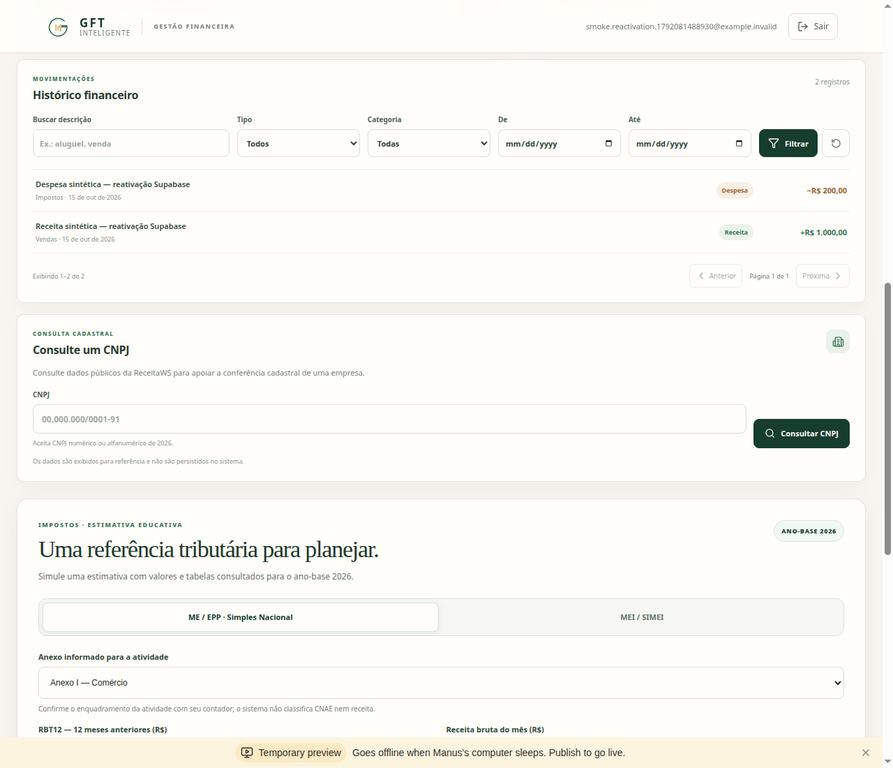
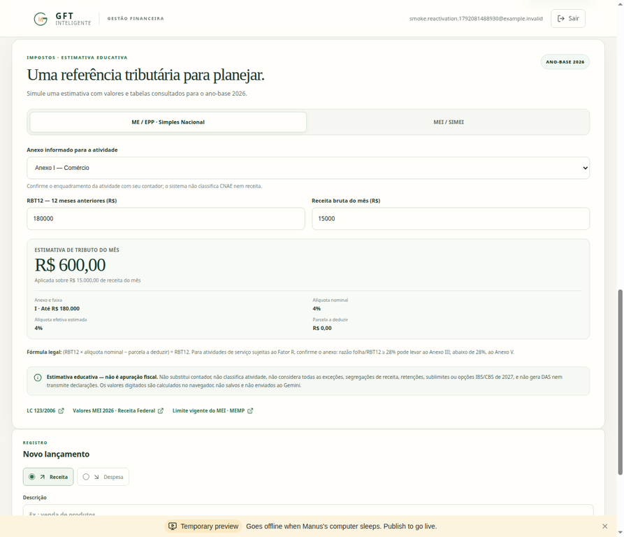
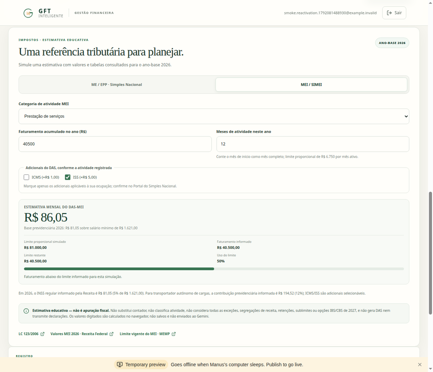

# GFT Inteligente — autenticação e validação na Preview

**Data:** 15/10/2026. **Estado atual:** conexão Supabase restabelecida; cadastro, login, logout, lançamentos, histórico e cenários do simulador verificados na Preview com dados sintéticos. O site não foi publicado, nenhuma credencial foi substituída e nenhum registro anterior foi excluído.

## Diagnóstico e resolução

Foram identificados dois problemas distintos. Nos modos de desenvolvimento, o formulário renderizava HTML sem handlers React ativos; o envio HTML podia usar GET e expor campos na URL. Login e cadastro passaram a usar POST, validação nativa, fallback seguro no BFF, erros visíveis e consentimentos versionados. A build otimizada local (`npm run build` e `npm run start`) ativou a hidratação na Preview. A causa da falha específica do modo dev não foi isolada.

A conexão PostgreSQL retornava erro de tenant/usuário não encontrado no Session Pooler; essa mensagem, por si só, **não demonstrava uma URI incorreta**. O usuário verificou que o projeto Supabase estava pausado e o reativou. Depois, **a mesma URL de conexão passou no teste read-only com TLS validado**, e o backend voltou a executar fluxos persistentes. A substituição de `DATABASE_URL` deixou de ser necessária; não houve substituição nem redefinição de senha.

O endpoint HTTP de saúde do NestJS não testa o banco. O HTTP 200 enquanto o projeto estava pausado não comprovava capacidade de cadastro/login. Não houve criação de sessão fictícia, bypass de JWT ou autenticação de desenvolvimento.

## Verificações realizadas

| Verificação | Evidência observada em 15/10 |
| --- | --- |
| PostgreSQL/Supabase | Conexão existente, TLS/CA validados e SELECT 1 em transação read-only aprovados |
| Cadastro pelo formulário React real | Uma nova conta/empresa sintética foi criada com os dois aceites; navegação para `/dashboard`, sem erros |
| Sessão após cadastro | `/api/auth/me` respondeu HTTP 200 |
| Receita pela interface | R$ 1.000,00 persistidos e incorporados automaticamente às métricas e ao histórico |
| Despesa pela interface | R$ 200,00 persistidos; saldo final de R$ 800,00 e dois lançamentos |
| Gráficos | Dois componentes de gráficos renderizados a partir dos lançamentos |
| Histórico financeiro | Dois registros visíveis; filtro por despesa retornou um registro; limpar filtros restaurou os dois |
| Paginação | API com `limit=1` retornou páginas 1 e 2 com itens distintos e total 2; interface padrão de 20 itens mostrou página 1 de 1 com navegação desabilitada |
| Logout pelo botão | Navegou para `/login`; sessão protegida respondeu HTTP 401 |
| Login pelo formulário real | Navegou para `/dashboard`; sessão HTTP 200, histórico e saldo persistidos reapareceram |
| Simples Nacional | Anexo I, RBT12 de R$ 180.000,00 e receita mensal de R$ 15.000,00: alíquota efetiva 4% e estimativa R$ 600,00 |
| MEI/SIMEI | Serviços, 12 meses e faturamento informado R$ 40.500,00: estimativa mensal R$ 86,05, limite R$ 81.000,00 e uso 50% |
| Inspeção visual fiscal | Campos, resultados, fontes e aviso de estimativa educativa legíveis no Dashboard autenticado |
| Typecheck, testes e build | Aprovados na revisão de código anterior do mesmo dia; frontend: 71 testes; backend: 48 testes |
| Cobertura configurada (registro histórico de 15/10) | 91,03% statements; 87,80% branches; 94,28% functions; 96,08% lines |

As contas e os lançamentos da demonstração usam dados sintéticos. O teste acrescentou **uma conta/empresa com aceite e dois lançamentos**, além dos eventos de auditoria do fluxo normal; todos foram preservados. Não houve exclusão nem consulta a senhas do usuário. A senha aleatória da conta de teste foi usada somente na demonstração, e seu armazenamento temporário no navegador foi removido após o teste de login. O documento e o pacote não incluem credenciais reais, a URI privada do banco ou JWTs válidos; os testes de código usam exemplos sintéticos.

Os testes unitários de sucesso/erro do fallback HTML usam NestJS simulado. O teste ponta a ponta desta retomada percorreu os formulários React/JSON e o Supabase real; não houve outro cadastro nativo HTML válido. A paginação de duas páginas foi exercitada na API. A interface não teve segunda página, pois a nova empresa tem apenas dois lançamentos. Essas evidências não representam cobertura exaustiva dos caminhos do produto.

## Correções de segurança preservadas

Login e cadastro usam POST com action relativa, validação HTML e Zod e mensagens de erro fixas. O contrato estrito de login recebe apenas e-mail e senha; somente o cadastro converte aceites em booleans e inclui versões dos documentos. Mensagens são obtidas por allowlist de propriedades próprias, sem renderizar chaves herdadas como `__proto__`. O JWT fica no BFF/cookie HttpOnly, configurado para Secure/SameSite=None em HTTPS Preview, e não é devolvido no JSON da interface. A origem é verificada e chamadas NestJS têm timeout de 15 segundos, sem repetição automática de operações com possível persistência incerta.

O simulador calcula valores somente no navegador, não gera DAS, não transmite declarações e não envia os dados fiscais ao Gemini. ReceitaWS e Gemini **não foram chamados novamente nesta retomada**; seus resultados anteriores continuam evidências históricas, não novas verificações de disponibilidade.

## Capturas da validação

## Situação acadêmica e próximos passos

A inspeção visual do histórico e do simulador está concluída para os cenários descritos. A Fase 3 permanece **preparada para revisão, não oficialmente submetida**. A revisão do orientador Alessandro Aparecido da Silva Horas, as correções acadêmicas e o envio pelo canal institucional até 19/10/2026 continuam pendentes. O restante do projeto mantém as funcionalidades parciais/futuras descritas na matriz; este teste não representa homologação integral nem conclusão de todas as fases.

A monografia foi consolidada para a Entrega 3: as evidências deste relatório passaram a integrar o texto principal, DOCX/PDF foram regenerados e o sumário estático foi conferido contra as páginas reais. Na versão então conferida, havia 33 páginas físicas e 35 títulos verificados, com figuras em ordem. Este relatório mantém o detalhamento complementar e as capturas, sem declarar submissão oficial ou homologação integral.

Para acessar, tentar novamente com os próprios dados na Preview. Se o cadastro ocorreu durante a pausa do banco, a conta pode não ter sido persistida; nesse caso, cadastrar-se novamente e observar a mensagem exibida. Não reenviar a URL do banco nem redefinir a senha apenas por causa do erro anterior do pooler.

## Revisão editorial final de 15/10/2026

A monografia revisada tem 30 páginas físicas, 35 títulos do sumário verificados e figuras 1–4 em ordem; a contagem anterior de 33 páginas pertence à revisão precedente. A ficha PFC foi regenerada com 16 páginas. Bibliografia e RF/RNF foram preservados. Esta revisão documental não constitui submissão acadêmica ou publicação do site.
